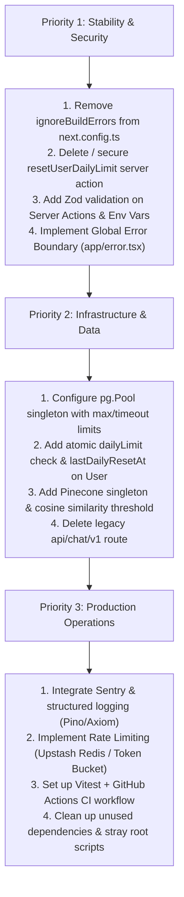

# DARC — Production Readiness & Architecture Audit

This document captures the comprehensive production readiness audit of the DARC codebase, detailing critical security vulnerabilities, concurrency flaws, database bottlenecks, AI/RAG limitations, and testing/observability gaps that separate the current implementation from a battle-tested production application.

---

## 1. Critical Security & Integrity Flaws

| Severity | Issue | Location | Impact & Risk |
|---|---|---|---|
| 🚨 **CRITICAL** | `typescript.ignoreBuildErrors: true` | [`next.config.ts`](../next.config.ts) | Production deployments succeed even with severe TypeScript type errors, allowing breaking runtime bugs to slip directly into production. |
| 🚨 **CRITICAL** | Exploitable `resetUserDailyLimit` Server Action | [`app/actions.ts`](../app/actions.ts) | Any authenticated user can invoke this exported server action directly from browser devtools to reset their `chatsUsed` to `0`, completely bypassing the daily prompt limit for free. |
| ⚠️ **HIGH** | Missing Request Rate Limiting | [`app/api/chat/v2/route.ts`](../app/api/chat/v2/route.ts) | There is no IP or token bucket rate limiter (e.g., Upstash / Redis). An automated script or malicious user can flood `/api/chat/v2`, spiking Google GenAI and Pinecone API bills while exhausting database connections. |
| ⚠️ **HIGH** | Missing Schema Validation on Server Actions | [`app/actions.ts`](../app/actions.ts) | `saveUserProfile` accepts arbitrary input without schema validation (such as Zod). Arbitrarily large strings, invalid URLs, or malicious payloads can be saved to user profile columns. |
| ⚠️ **MEDIUM** | Missing HTTP Security Headers | [`next.config.ts`](../next.config.ts) | Lacks essential security headers: `Content-Security-Policy` (CSP), `X-Frame-Options: DENY`, `X-Content-Type-Options: nosniff`, and `Strict-Transport-Security` (HSTS). |
| ⚠️ **MEDIUM** | Wildcard Localhost in `trustedOrigins` | [`lib/auth.ts`](../lib/auth.ts) | `"http://localhost:*"` and `"http://127.0.0.1:*"` are hardcoded in `trustedOrigins` in production, allowing potential origin spoofing from local processes. |
| ⚠️ **MEDIUM** | Exposed Legacy Route | [`app/api/chat/v1/route.ts`](../app/api/chat/v1/route.ts) | 539 lines of unmaintained legacy v1 chat streaming logic remain publicly accessible, increasing the attack surface. |

---

## 2. Database & State Concurrency Deficiencies

1. **Daily Limit Race Condition & Inefficient Scans**:
   - In [`app/api/chat/v2/graph.ts`](../app/api/chat/v2/graph.ts), on **every single message turn**, the server runs `db.message.findFirst` across all user messages to determine if the day has rolled over. As user history grows, this causes repetitive table scans.
   - The limit check and increment are non-atomic (`chatsUsed < dailyLimit` followed by `chatsUsed: { increment: 1 }`). Concurrent incoming requests can easily bypass the daily prompt ceiling.
   - **Remediation**: Add a `lastDailyResetAt DateTime?` column to `User` and enforce atomic updates:
     ```sql
     UPDATE "user"
     SET chats_used = chats_used + 1
     WHERE id = $1 AND chats_used < daily_limit;
     ```

2. **PostgreSQL Connection Pool Leaks**:
   - In [`lib/db.ts`](../lib/db.ts), while the `PrismaClient` instance is cached on `globalThis`, `const pool = new Pool({ connectionString })` is instantiated top-level on every file re-evaluation without connection pool bounds (`max`, `idleTimeoutMillis`, `connectionTimeoutMillis`). In serverless environments, this quickly exhausts PostgreSQL connection limits (e.g., Supabase connection pool exhaustion).

3. **Missing `updatedAt` on `Chat`**:
   - In [`prisma/schema.prisma`](../prisma/schema.prisma), the `Chat` model only has `createdAt`. When a user resumes an older chat, there is no `updatedAt` timestamp to order conversations by most recently active.

4. **Missing Billing & Subscription Infrastructure**:
   - The landing page displays $5/month and $30/year pricing plans, but there is zero billing integration (no Stripe/Razorpay webhooks, no `Subscription` table, and the CTA buttons simply route to `/chat`).

---

## 3. AI, RAG & LangGraph Resilience

1. **Unfiltered Pinecone Vector Search**:
   - In [`lib/rag.ts`](../lib/rag.ts), `new Pinecone(...)` is instantiated on every single query rather than reusing a shared singleton client.
   - `topK: 5` injects transcripts into the system prompt regardless of cosine similarity score. Low-similarity chunks (e.g., similarity < 0.65) dilute prompt context, degrade coach answer quality, and consume unnecessary context tokens.
   - Lacks semantic caching (e.g., caching search results for repeated user queries).

2. **Retrying Streaming Generator Nodes**:
   - In [`app/api/chat/v2/graph.ts`](../app/api/chat/v2/graph.ts), `generateResponse` has `{ retryPolicy: defaultRetryPolicy }`. Retrying a generator node that has already emitted chunks over an open Server-Sent Events (SSE) connection can yield duplicated tokens or client stream corruption on network blips.

3. **Naive Output Safety Filtering**:
   - `BANNED_PHRASES` in [`lib/coaching.ts`](../lib/coaching.ts) only checks 4 hardcoded lowercase strings. Production LLM systems should enforce structured guardrails (e.g., Google GenAI Safety Settings thresholds, Llama Guard, or NeMo Guardrails) rather than simple string substring matching.

---

## 4. Zero Observability & Telemetry

1. **Logging Completely Disabled in Production**:
   - In [`lib/logger.ts`](../lib/logger.ts):
     ```ts
     if (process.env.NODE_ENV === "production") return;
     ```
     In production, the application writes zero diagnostic execution logs.
2. **Missing APM & Error Tracking**:
   - No Sentry, Axiom, Datadog, or OpenTelemetry instrumentation. If a user encounters an SSE disconnect, database pool timeout, or Gemini API outage in production, developers have zero real-time visibility.
3. **Leftover Debug `console.log` Statements**:
   - Diagnostic `console.log` statements dumping query texts and raw vector metadata remain in production paths (such as [`lib/rag.ts`](../lib/rag.ts)).

---

## 5. Testing, CI/CD & Code Hygiene

1. **Zero Tests**:
   - The repository contains **0 unit tests**, **0 integration tests**, and **0 end-to-end tests**. There is no test runner (Vitest, Jest, or Playwright) configured in `package.json`.
2. **Missing CI/CD Pipeline**:
   - No `.github/workflows` to run automated type checking (`tsc --noEmit`), linting (`eslint`), and builds on pull requests or commits.
3. **Dead / Unused Dependencies**:
   - `@supabase/ssr`, `@supabase/supabase-js`, `kysely`, and `@better-auth/kysely-adapter` are present in `package.json` despite the project using Better-Auth with the Prisma PostgreSQL adapter.
4. **Missing Next.js App Router Fallbacks**:
   - Missing [`app/error.tsx`](../app/error.tsx) (Global React Error Boundary).
   - Missing [`app/not-found.tsx`](../app/not-found.tsx) (Custom 404 page).
   - Missing [`app/loading.tsx`](../app/loading.tsx) (App-level Suspense loading boundary).
5. **Stray Scripts in Repository Root**:
   - Temporary migration scripts (`replace.js`, `replace.py`) and a 1.15 MB log file (`darc-execution.log`) sit committed or untracked in the root folder.

---

## 6. Recommended Priority Roadmap


